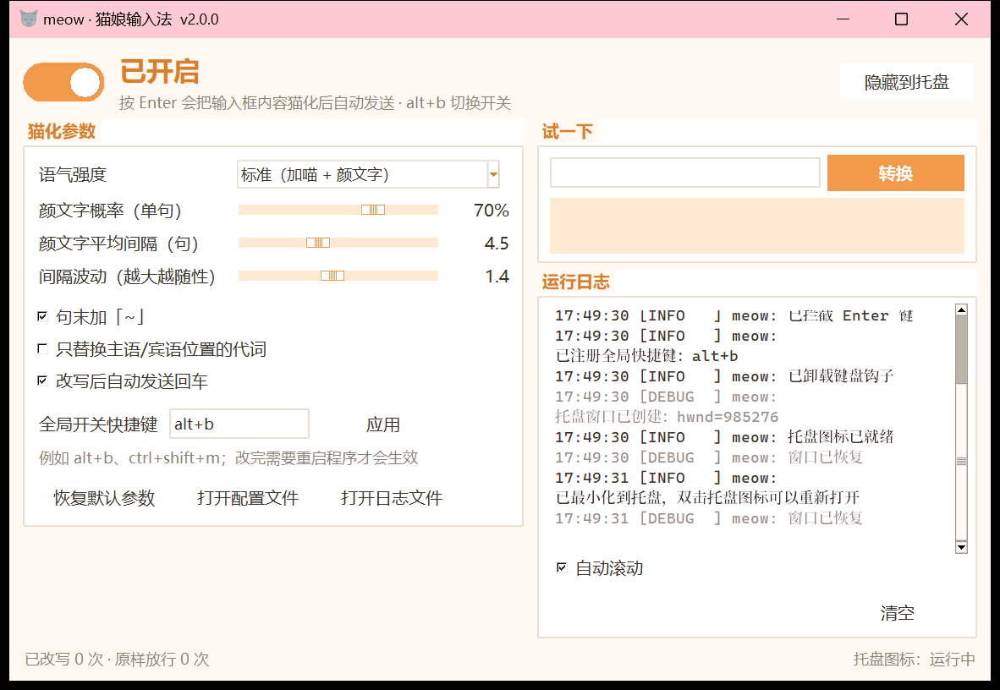
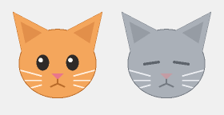

# meow 🐱 · 猫娘输入法

按一下回车，输入框里的文字就自动变成猫娘口吻，然后帮你发出去。

> `你在做什么？` → `主人在做什么喵~？(・ω・)`
>
> `好的，我知道了` → `好哒，本喵知道了啦喵~(=･ω･=)`
>
> `今天天气真好` → `今天天气真好喵~(๑>◡<๑)`

微信、QQ、TIM、Discord、浏览器……任何能打字的地方都能用。程序挂在后台，
不改变你原本的输入习惯：**只是每次按回车时，悄悄帮你把话「猫」一下**。



---

## 目录

- [特性](#特性)
- [环境要求](#环境要求)
- [安装](#安装)
- [快速开始](#快速开始)
- [界面说明](#界面说明)
- [参数说明](#参数说明)
- [托盘与退出](#托盘与退出)
- [命令行参数](#命令行参数)
- [工作原理](#工作原理)
- [项目结构](#项目结构)
- [从 v1 升级](#从-v1-升级)
- [常见问题](#常见问题)
- [开发者](#开发者)
- [已知限制](#已知限制)

---

## 特性

- **一个回车搞定** —— 拦截 Enter，读走输入框内容，改写后写回并自动发送。
- **图形界面** —— 开关状态、参数调节、实时日志都在一个窗口里。
- **收进托盘** —— 关掉窗口不会退出程序，而是缩到任务栏右下角继续工作。
- **右键退出** —— 只有右键点托盘图标，才有「退出 meow」这个选项。
- **双通道读写** —— 优先用 UIAutomation 直接读写控件（不碰你的剪贴板）；
  遇到微信这类自绘输入框，自动退回剪贴板方式，两种方式都失败就原样放行。
- **零额外依赖** —— 界面用标准库自带的 tkinter，托盘用 ctypes 调 Win32 API，
  图标是代码画出来的，不需要 PyQt / pystray / Pillow。
- **参数实时生效** —— 拖滑块就能看到「试一下」里的效果，不用重启。

---

## 环境要求

| 项目 | 要求 |
| --- | --- |
| 操作系统 | Windows 10 / 11（依赖 Win32 托盘 API 和 UIAutomation） |
| Python | 3.9 及以上（开发环境为 3.13） |
| 权限 | 普通权限即可。**如果目标窗口是以管理员身份运行的，本程序也要以管理员身份运行** |

---

## 安装

```bat
:: 1. 克隆或下载本项目，进入目录
cd meow

:: 2. 建一个虚拟环境（可选，但推荐）
python -m venv .venv
.venv\Scripts\activate

:: 3. 装依赖
python -m pip install -r requirements.txt
```

依赖只有四个：`jieba`（中文分词）、`keyboard`（键盘钩子）、
`uiautomation`（读写输入框）、`pyperclip`（剪贴板兜底）。

---

## 快速开始

三种启动方式，挑一个：

```bat
:: 方式一：带控制台（方便看日志、排查问题）
python main.py

:: 方式二：不带黑色控制台窗口（推荐日常使用）
pythonw main.py

:: 方式三：直接双击
start_meow.vbs
```

启动后窗口里默认是**关闭**状态。点左上角的拨杆（或者按 `Alt+B`）打开它，
然后去微信 / QQ / 浏览器里打一句话按回车试试。

---

## 界面说明

```
┌──────────────────────────────────────────────────────────────┐
│  (拨杆)  已开启                                              │
│          按 Enter 会把输入框内容猫化后自动发送 · alt+b 切换   │
├───────────────────────────┬──────────────────────────────────┤
│  猫化参数                 │  试一下                          │
│   · 语气强度              │   [输入框]            [转换]     │
│   · 颜文字概率            │   ─────────────────────────────  │
│   · 颜文字平均间隔        │   运行日志                       │
│   · 间隔波动              │   17:49:30 [INFO] 改写成功 ...   │
│   · 三个开关              │   ...                            │
│   · 快捷键                │                                  │
├───────────────────────────┴──────────────────────────────────┤
│  已改写 12 次 · 原样放行 3 次          托盘图标：运行中       │
└──────────────────────────────────────────────────────────────┘
```

- **拨杆**：橙色 = 已开启，灰色 = 已关闭。点一下就能切换。
- **试一下**：在这里输入文字点「转换」，可以先用当前参数预览效果，
  不会动你的输入框，也不会发出去。
- **运行日志**：和 `data/logs/meow.log` 内容完全一致，改了什么、读到了什么、
  哪一步失败都写在这里。按 `Ctrl+L` 清空。

---

## 参数说明

参数会立刻保存在 `data/settings.json`，下次启动自动恢复。

| 参数 | 含义 | 默认值 |
| --- | --- | --- |
| **语气强度** | `标准`：句末加「喵」+ 颜文字；`轻度`：只加「喵」；`仅替换用词`：不加语气词，只换词 | 标准 |
| **颜文字概率（单句）** | 整段只有一句话时，加颜文字的概率 | 70% |
| **颜文字平均间隔（句）** | 多句时，平均每隔几句加一个颜文字（正态分布的均值） | 3.0 |
| **间隔波动** | 间隔的标准差。调大 → 有的地方密集、有的地方稀疏，更自然 | 1.0 |
| **句末加「~」** | 每句话结尾补一个波浪号 | 开 |
| **只替换主语/宾语位置的代词** | 开启后只换主语和宾语位置的「我 / 你」，避免误伤「我觉得」这类用法 | 关 |
| **改写后自动发送回车** | 关掉后只改写不发送，方便先看一眼再自己按回车发送 | 开 |
| **全局开关快捷键** | 默认 `Alt+B`。支持 `ctrl+shift+m` 这样的组合，改完需重启生效 | `alt+b` |

### 颜文字是怎么分布的

不是机械地每句都加，而是按正态分布撒点，所以读起来会有「一段密集、
一段稀疏」的节奏感。多句时的间隔服从 `N(平均间隔, 波动)`，
再用 `max(1, ...)` 兜底，保证不会出现负数间隔。

---

## 托盘与退出

程序运行时会一直在通知区域显示一个猫头图标：

- 🟠 **橘猫（睁眼）** = 猫化已开启
- ⚪ **灰猫（眯眼）** = 猫化已关闭



图标不是图片文件，而是启动时用代码画出来并缓存到 `data/icons/` 的，
所以不需要 Pillow，也不怕丢资源。

| 操作 | 效果 |
| --- | --- |
| 点窗口右上角的 `×` | **不退出**，窗口收进托盘（任务栏里也会消失） |
| 点「隐藏到托盘」按钮 / 按 `Esc` | 同上 |
| 双击托盘图标 | 重新打开主界面 |
| **右键**托盘图标 | 弹出菜单：切换开关 / 显示主界面 / 打开日志 / 打开配置文件 / **退出 meow** |

> **退出程序只有一个入口：右键托盘图标 → 退出 meow。**
>
> 唯一的例外是托盘图标注册失败时（比如在受限的沙箱环境里运行），
> 界面右上角会出现一个「退出」按钮兜底，此时关闭窗口会直接退出程序。

---

## 命令行参数

```
python main.py [选项]

  （无参数）              启动图形界面
  --headless              无界面模式，只在控制台输出日志（适合服务器/调试）
  --no-tray               不创建托盘图标，关闭窗口即退出
  --data-dir DIR          指定配置/日志/图标的存放目录（默认 ./data）
  --log-level LEVEL       DEBUG / INFO / WARNING / ERROR（默认 INFO）
  --self-test             检查运行环境后退出，用来排查问题
  --version               显示版本号
```

常用组合：

```bat
:: 排查问题：输出 DEBUG 日志并自检
python main.py --self-test
python main.py --log-level DEBUG

:: 后台常驻、不要界面、不要托盘
python main.py --headless

:: 把配置丢到别处（也可以用环境变量 MEOW_DATA_DIR）
python main.py --data-dir D:\meow-data
```

`--self-test` 会逐项检查 Python 版本、四个依赖、tkinter、改写引擎、
配置目录可写性、图标生成和托盘注册，并把结论直接打出来。

---

## 工作原理

```
          ┌──────────────┐
   按键 ─→│  EnterHook   │  低层键盘钩子：吞掉 Enter，丢进工作线程
          └──────┬───────┘
                 │（回调里绝不阻塞，否则整个键盘都会卡）
          ┌──────▼───────┐
          │ MeowService  │  业务编排：开不开？读什么？写什么？发不发？
          └──┬────────┬──┘
             │        │
   ┌─────────▼──┐  ┌──▼──────────────┐
   │ TextGateway│  │  CatifyEngine   │
   │  UIA → 剪贴板│  │ 纯文本改写，无 IO │
   └────────────┘  └─────────────────┘
```

一次回车的完整流程：

1. 钩子看到 Enter **按下**，先看开关是否打开。没打开就完全不管这次按键；
2. 开关打开时吞掉这次 Enter，把处理扔进后台线程（避免卡住系统键盘）；
3. `TextGateway` 依次尝试 **UIAutomation → 剪贴板** 读取输入框内容；
4. `CatifyEngine` 按当前参数改写：短语替换 → 补主语 → 分词换人称 →
   加语气词 → 加波浪号 → 补标点 → 撒颜文字；
5. 用**读成功的那个通道**写回（写失败会自动换另一个通道重试）；
6. 补发一次 Enter 真正发送出去。这次 Enter 会被钩子识别为自己的，直接放行。

任何一步出问题（读不到、写不进、结果为空），都会**原样放行**——
宁可什么都不做，也不能把你的话弄丢。

---

## 项目结构

v2 把原来单文件的两段代码拆成了分层结构，每层只依赖它下面的一层：

```
meow/
├── main.py                  启动入口
├── demo.py                  兼容入口（等价于 main.py）
├── catify.py                兼容层：老的 import catify 仍然可用（已废弃）
├── start_meow.vbs           双击启动（不带控制台窗口）
├── requirements.txt
│
├── meow/                    主包
│   ├── engine/              纯文本改写引擎（不碰任何 Windows API，可单独测试）
│   │   ├── lexicon.py         词库：人称表、短语表、颜文字库、情绪词
│   │   ├── sentence.py        切句、句式分类、情绪分类（纯字符串处理）
│   │   ├── analyzer.py        分词分析：判断缺不缺主语、替换人称代词
│   │   ├── catifier.py        引擎主体 CatifyEngine
│   │   └── params.py          参数模型 CatifyParams
│   │
│   ├── input/               输入框读写
│   │   ├── base.py            InputBackend 协议 + Field
│   │   ├── uia_backend.py     UIAutomation 后端（含 COM 线程初始化）
│   │   ├── clipboard_backend.py  剪贴板后端
│   │   └── gateway.py         多后端降级网关
│   │
│   ├── hooks/               键盘钩子
│   │   └── enter_hook.py      拦截 Enter、注册快捷键、防重入、补发 Enter
│   │
│   ├── tray/                托盘图标
│   │   ├── win32.py           Win32 API 的 ctypes 绑定
│   │   ├── icons.py           纯 Python 画猫头 .ico（不需要 Pillow）
│   │   └── tray.py            TrayIcon：独立线程 + 消息循环 + 右键菜单
│   │
│   ├── ui/                  图形界面
│   │   ├── theme.py           配色与 ttk 样式
│   │   ├── widgets.py         拨杆开关、日志面板
│   │   └── app.py             主窗口
│   │
│   ├── service.py           业务编排（开不开、一次回车做什么）
│   ├── bootstrap.py         依赖装配：唯一知道「有哪些实现」的地方
│   ├── config.py            配置模型与 JSON 持久化
│   ├── events.py            线程安全的发布/订阅
│   ├── logging_setup.py     日志：控制台 + 滚动文件 + 界面回调
│   ├── paths.py             数据目录解析
│   └── cli.py               命令行入口 / 自检
│
└── tests/                   unittest 测试（99 个用例，不需要 pytest）
    ├── fakes.py               假后端、假剪贴板、假键盘、临时目录
    ├── test_engine.py         改写引擎 + 黄金样本回归
    ├── test_config.py         配置读写与容错
    ├── test_input.py          后端降级、剪贴板读写
    ├── test_hooks.py          钩子拦截/放行/补发时机
    └── test_service.py        一次回车的完整流程
```

### 重构做了哪些事

| 原来的问题 | 现在的做法 |
| --- | --- |
| 改写逻辑、界面逻辑、IO 全挤在一起 | 按 engine / input / hooks / tray / ui 分层，`service` 负责编排 |
| 直接 `import uiautomation`、`keyboard` | 这些都以参数注入，测试里换成假实现，不需要真窗口 |
| 到处 `print` | 全部走 `logging`，界面通过 handler 订阅，和日志文件内容一致 |
| 用全局 `random.seed()` | 引擎持有自己的 `random.Random` 实例，线程安全、测试可复现 |
| 词库混在逻辑里 | 语料集中在 `lexicon.py`，改词不用动逻辑 |
| 参数写死在调用处 | `CatifyParams` 数据类，带范围校验，能存能读能 clamp |
| 没有测试 | 99 个 unittest 用例，含与 v1 逐字节比对的黄金样本 |
| 配置靠手改代码 | `data/settings.json`，界面里改，损坏了也能自愈回默认值 |

---

## 从 v1 升级

v1 只有一个 `catify.py` 和一个 `demo.py`。v2 保留了兼容入口：

- `import catify; catify.catify("你好", seed=42)` 仍然可用（内部转发到新引擎），
  确认没有旧脚本依赖后可以直接删掉 `catify.py`；
- `python demo.py` 等价于 `python main.py`；
- 老的自测代码搬到了 `python main.py --self-test`，
  直接运行 `python catify.py` 也能看到改写效果演示。

### 行为上的差异

重构以「输出不变」为第一目标，多个随机种子 × 多组参数下与 v1 逐字节比对
**0 处不一致**（见 `tests/test_engine.py` 里的黄金样本）。只有下面三处
**有意**改动，都是修 bug：

1. **修掉了换行丢失**。v1 只在遇到空行时才补换行，于是
   `"第一行\n第二行"` 会被拼成一行，`"a\n\nb"` 会被压成一个换行。
   现在重建后的行结构与原文完全一致。
2. **修掉了剪贴板兜底的误判**。v1 把剪贴板清空后再 `Ctrl+C`，却只用
   `text is None` 判断失败；遇到不支持复制的应用会误判成「读到了空字符串」，
   接着把输入框清空并回车发出去。现在「复制后依然是空」也算读取失败，
   直接原样放行，不做破坏性操作。
3. **空文本不再返回换行**。`catify("")` 从 `"\n"` 变成 `""`。

另外，输出里的 `print` 全部换成了 `logging`，日志写在 `data/logs/meow.log`。

---

## 常见问题

**Q：按回车没反应？**
1. 看界面左上角的拨杆是不是「已开启」；
2. 看日志区最后几行，有没有「两种方式都读不到输入框内容」；
3. 如果目标程序是**以管理员身份运行**的，本程序也要以管理员身份运行
   （Windows 不允许普通权限程序往高权限窗口注入输入）；
4. 跑一下 `python main.py --self-test` 看依赖是否齐全。

**Q：微信里能用吗？**
能。微信 4.x 的输入框读不到内容时会自动退回剪贴板方式
（会短暂借用一下你的剪贴板，用完立刻还原）。

**Q：会不会改坏我输入的内容？**
不会。任何一步失败都走「原样放行」：读到空、写回失败、结果为空、
异常中断，都会补发一次干净的 Enter，让内容原封不动地发出去。

**Q：怎么让猫味更浓 / 更淡？**
- 想让每句都有颜文字：把「颜文字平均间隔」调到 1，波动调到 0；
- 想克制一点：把「语气强度」改成「轻度」，「颜文字概率」调低；
- 想只换人称不动语气：选「仅替换用词」。

**Q：怎么加自己的口头禅 / 颜文字？**
改 `meow/engine/lexicon.py` 就行，那里集中了所有语料：
`PHRASE_MAP`（固定短语替换）、`PRONOUN_MAP`（人称）、`KAOMOJI`（颜文字库）、
`HAPPY_CHARS` 等（情绪判断用字）、`NO_SUBJECT_PHRASES`（不需要补主语的整句）。
改完重启程序即可，不用动逻辑代码。

**Q：数据存在哪？**
默认在项目目录下的 `data/`：`settings.json`（配置）、`logs/meow.log`（日志）、
`icons/`（画出来的图标缓存）。可以用 `--data-dir` 或环境变量 `MEOW_DATA_DIR` 换地方。

**Q：托盘图标没出现？**
说明 `Shell_NotifyIcon` 被系统拒绝了，常见于受限/沙箱环境（进程完整性级别过低）
或资源管理器没在运行。界面右上角会出现「退出」按钮兜底，此时关窗口就是退出程序。
以普通方式双击运行时不会有这个问题。

---

## 开发者

```bat
:: 跑测试（99 个用例，纯标准库 unittest，不需要 pytest）
python -m unittest discover -s tests -t . -v

:: 环境自检
python main.py --self-test

:: 调试模式启动
python main.py --log-level DEBUG
```

### 想改点东西

| 想做的事 | 改哪里 |
| --- | --- |
| 加词、加颜文字、调情绪词 | `meow/engine/lexicon.py` |
| 改改写步骤（比如句末标点规则） | `meow/engine/catifier.py` |
| 加一个输入框读写方式 | 在 `meow/input/` 加一个实现 `read()/write()` 的类，注册进 `default_gateway()` |
| 加一个配置项 | `meow/engine/params.py`（引擎参数）或 `meow/config.py`（应用设置），再加界面控件 |
| 改界面配色 | `meow/ui/theme.py` 顶部的 `COLORS` |
| 改图标长相 | `meow/tray/icons.py` 的几何常量，记得把 `ICON_VERSION` 加 1 |

图标是代码画出来的（椭圆脸 + 三角耳 + 眼睛鼻子胡须，超采样抗锯齿），
改完 `ICON_VERSION` 会自动重新生成缓存。

---

## 已知限制

- 仅支持 Windows。
- 对**以管理员身份运行**的程序无效，除非本程序也以管理员身份运行。
- 少数使用 DirectInput / 独占全屏的游戏、以及部分 UWP 应用拦不到回车。
- 中文输入法正在组词时，回车可能先被输入法吃掉，这是输入法的行为，钩子看不到。
- 剪贴板兜底会短暂占用剪贴板（读完/写完立刻还原），极少数情况下可能和
  剪贴板管理器打架。
- 托盘图标在进程完整性级别过低的环境（部分沙箱）里无法注册，会自动降级。

---

## 许可

仅供学习和个人娱乐使用。请遵守你所在聊天平台的使用条款，
以及和你聊天的人的意愿——毕竟猫娘化别人说的话，对方不一定觉得可爱 🐾
